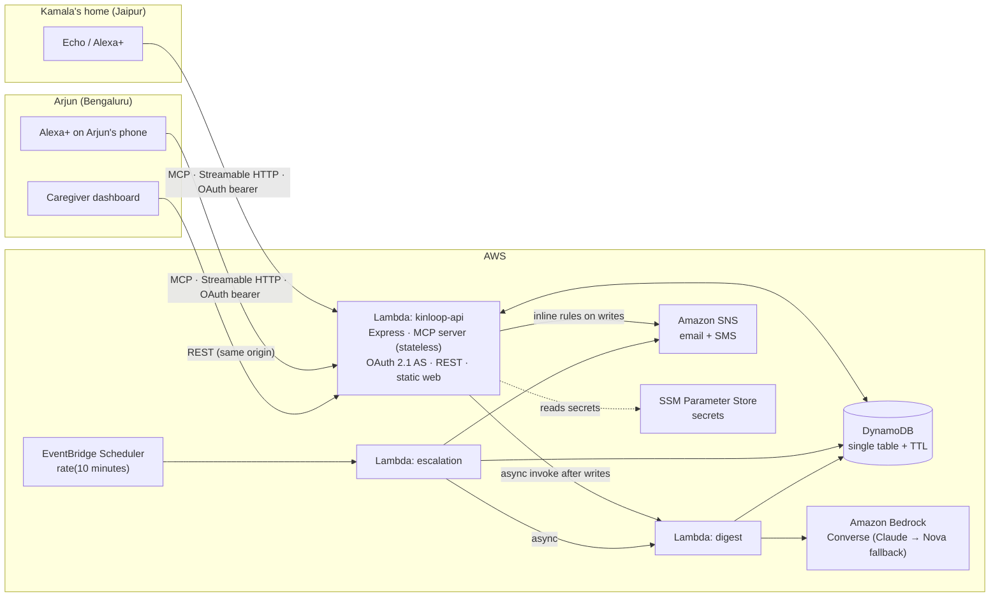

# KinLoop build plan

Deadline: **Oct 24, 12:30 AM IST, which is Oct 23 at 2:00 PM Chicago time.** Stop building at least 4 hours before it.

## Architecture



- **Rules decide, the LLM only writes.** The escalation logic lives in `packages/core/src/rules` as pure functions. Bedrock is called only off the request path, to write the family digest.
- **Stateless MCP.** Each request builds a new `McpServer` and `StreamableHTTPServerTransport` with `sessionIdGenerator: undefined` and `enableJsonResponse: true`. All state comes from the bearer token (household and member) plus DynamoDB.
- **One origin.** The Lambda Function URL serves `/mcp`, the OAuth endpoints, `/.well-known/*`, `/api/*` and the statically exported Next.js app (dashboard, simulator, privacy, terms).
- **Local mode.** `pnpm dev` runs the same Express app against an in-memory store that is seeded with the demo household. It needs no AWS account. Bedrock and SNS fall back to a template digest and a console notifier.

## File tree

```
apps/mcp-server/     Express app: MCP tools, OAuth AS, REST API, Lambda handlers
  src/mcp/           tool definitions + spoken responses
  src/oauth/         authorization server, PKCE, tokens, metadata
  src/handlers/      lambda entry points (api, escalation, digest)
  src/store/         Store interface, MemoryStore, DynamoStore
  src/services/      notifier (SNS/Telegram/console), digest (Bedrock), simulator orchestrator
  test/              integration tests (MCP, OAuth, isolation)
apps/web/            Next.js (static export): dashboard, simulator, setup, privacy, terms
packages/core/       domain types, time utils, rules engine (100% coverage)
infra/template.yaml  AWS SAM: Lambda ×3, DynamoDB, Scheduler, SNS, SSM, IAM
addon-package/       addon.json + generated icons/carousel
submission/          Devpost kit
scripts/             deploy, latency, asset generation
```

## Hour-by-hour plan with cut lines

| Hours | Milestone | Cut if late |
|---|---|---|
| 0–3 | Monorepo, core types, rules engine + 100% tests, Store layer, seed | — |
| 3–8 | MCP server, all 9 tools, annotations, spoken responses, latency script | — |
| 8–12 | OAuth 2.1 + PKCE AS, metadata, 401 behavior, auth flow tests, isolation test | Rate limiting falls back to per-instance memory |
| 12–16 | SAM deploy: Lambdas, DynamoDB, Scheduler, SNS, Bedrock digest | Telegram channel |
| 16–22 | Alexa AI CLI, addon.json, icons, deploy, Local Inspector, simulator | **CUT LINE A**: if the Alexa+ add-on is blocked, the simulated client is the primary demo |
| 22–28 | Dashboard + simulated Alexa+ client (Bedrock tool-use over our MCP) | Audio messages; 7-day charts become tables |
| 28–32 | MCP Apps UI cards for Echo Show | **CUT LINE B**: skip |
| 32–38 | Polish, README, submission kit, dress rehearsal | — |
| 38+ | Record video, submit, keep a 1-hour buffer | — |
