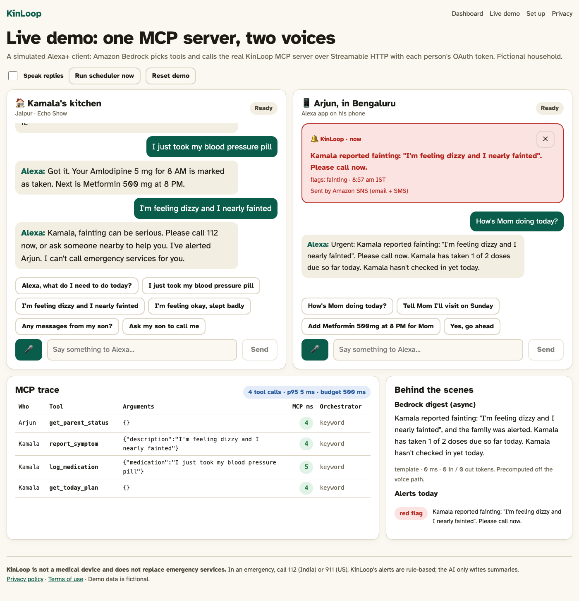
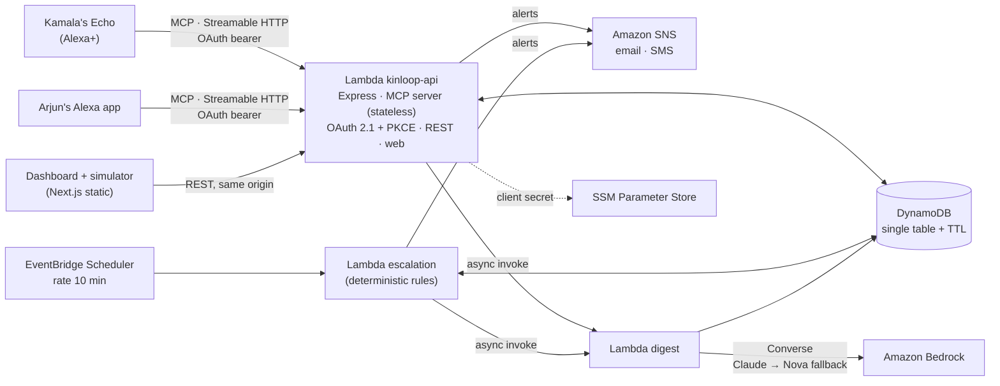
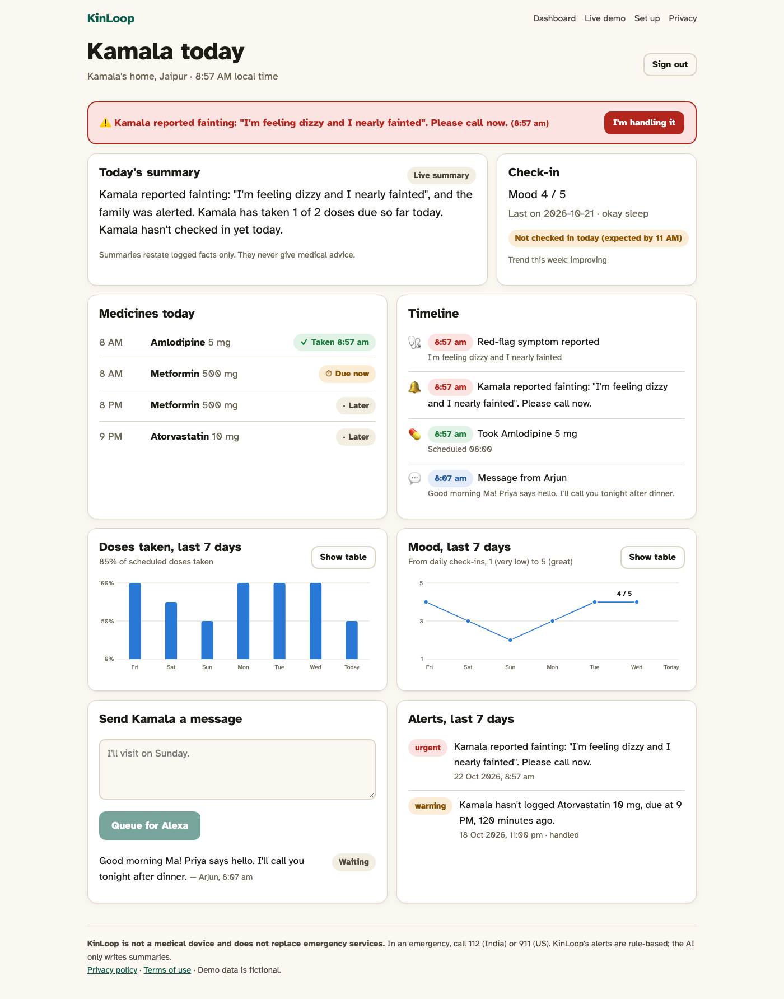
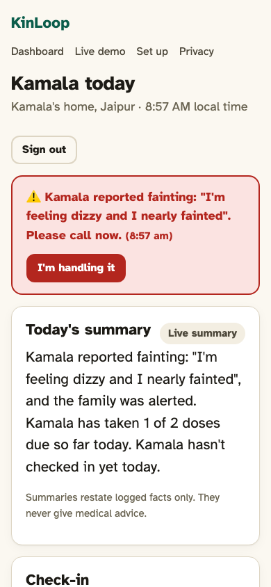

# KinLoop

**Your parents' daily check-in, through Alexa.**

KinLoop is an Alexa+ add-on built as a self-hosted **MCP server** (spec 2025-11-25, Streamable HTTP, stateless). An elderly parent manages their day just by talking: medicines, check-ins, symptoms and family messages. Their family gets a calm, accurate picture of the day plus an instant alert when something needs them.

**Rules decide, the LLM only writes.** Escalation is deterministic code with 100% test coverage. Amazon Bedrock writes the family's daily summary asynchronously, off the voice path.

> KinLoop is not a medical device and does not replace emergency services. The demo household ("Kamala, 72, Jaipur" and her son "Arjun, Bengaluru") is fictional.

- **Live:** [https://aitklljfxl5zbu3rgkec7e726m0yzgtm.lambda-url.ap-southeast-2.on.aws/simulator/](https://aitklljfxl5zbu3rgkec7e726m0yzgtm.lambda-url.ap-southeast-2.on.aws/simulator/) (demo) · MCP endpoint `https://aitklljfxl5zbu3rgkec7e726m0yzgtm.lambda-url.ap-southeast-2.on.aws/mcp`
- **Track:** Alexa+ · **Mini challenge:** AWS Builder
- Submission kit: [`submission/`](submission/) · Friction log: [`FRICTION_LOG.md`](FRICTION_LOG.md) · Security: [`SECURITY.md`](SECURITY.md) · Build plan: [`PLAN.md`](PLAN.md)



## What it does

| Who | Say | Tool | What happens |
|---|---|---|---|
| Parent | "What do I need to do today?" | `get_today_plan` | Medicines with times and status, appointments, waiting messages. Read-only. |
| Parent | "I just took my blood pressure pill." | `log_medication` | Matched by name or purpose to the nearest scheduled dose. Idempotent. |
| Parent | "I'm feeling okay, slept badly." | `daily_check_in` | Mood 1–5, sleep, note. |
| Parent | "I'm feeling dizzy and I nearly fainted." | `report_symptom` | Deterministic red-flag rules. A red flag alerts the family now and tells the parent to call 112/911. |
| Parent | "Ask my son to call me." | `request_callback` | "Please call" notification, deduped for 15 minutes. |
| Parent | "Any messages from my son?" | `play_family_messages` | Reads them, marks them heard. |
| Family | "How's Mom doing today?" | `get_parent_status` | Doses, check-in, mood trend, alerts, and the precomputed Bedrock digest. Read-only. |
| Family | "Tell Mom I'll visit on Sunday." | `send_message_to_parent` | Queued for her next conversation. |
| Family | "I'm calling her now." | `acknowledge_alert` | Marks open alerts handled, and the parent hears "Arjun has seen your alert". Idempotent. |
| Family | "Add Metformin 500 mg at 8 PM for Mom." / "I picked up 60 Metformin tablets." | `update_medication_schedule` | Add, change, remove or **refill**. Read back first; applied only after a clear yes (`confirm: true`). `destructiveHint`. |

**Hindi and Hinglish.** Kamala can speak Hindi. "मुझे सीने में दर्द हो रहा है", "saans nahi aa rahi" and "bathroom mein gir gayi" all trip the same deterministic red-flag rules as English, including Hindi's trailing negation ("dard nahi hai" is not a red flag). "BP ki goli le li" logs Amlodipine.

**Refill countdown.** Each logged dose counts one tablet off a tracked supply. Kamala hears "You have about 4 days of Metformin left", and Arjun gets one refill alert per supply.

**Echo Show.** `get_today_plan` and `get_parent_status` return `_meta.ui.resourceUri`. The live demo fetches the card with `resources/read` and renders it in a sandboxed iframe through the MCP Apps `ui/initialize` and `ui/notifications/tool-result` handshake.

**Escalation rules** ([`packages/core/src/rules`](packages/core/src/rules)):
- A missed dose gets a gentle reminder to the parent at +60 min and a family alert at +120 min.
- No check-in by 11:00 local alerts the family.
- Chest pain, trouble breathing, a fall, fainting, confusion or stroke signs alert the family immediately.
- Three or more low-mood days in a row trigger a "consider calling" nudge.
- Five days or less of a medicine left triggers one refill alert per supply.
- Alerts are deduplicated per incident.
- The rules run on EventBridge Scheduler every 10 minutes, plus inline on every write.

## Architecture




- **Stateless MCP:** each POST builds a fresh `McpServer` and `StreamableHTTPServerTransport` with `sessionIdGenerator: undefined` and `enableJsonResponse: true`. The household and person come from the bearer token, and all state is in DynamoDB. `Mcp-Session-Id` is never used.
- **Under 500 ms:** no LLM on the hot path. The digest is written by an async Lambda after each write and on the schedule. If the stored digest is older than the latest event, `get_parent_status` speaks a deterministic live summary instead, so it never reads out stale facts.
- **Spoken responses:** every tool returns `structuredContent` and a `content` text version of the same facts, written to be read aloud. `get_today_plan` and `get_parent_status` also set `_meta.ui.resourceUri` to an MCP Apps card (`ui://kinloop/*`, `text/html;profile=mcp-app`) for Echo Show.
- **Auth:** OAuth 2.1 authorization code flow with PKCE S256 only, the `resource` parameter (RFC 8707), Protected Resource Metadata (RFC 9728), AS metadata (RFC 8414), and rotating refresh tokens (refresh without `resource`, as Alexa+ sends it). Clients are statically registered (no DCR). Codes and tokens are stored only as SHA-256 hashes; PINs use scrypt. Unauthenticated calls get `401` with a JSON body and **no** `WWW-Authenticate`. Tokens are accepted only from the header.
- **Isolation:** every query is keyed by the token's household ID, and [a test](apps/mcp-server/test/mcp.test.ts) proves cross-household reads and writes fail.

```
apps/mcp-server   Express app: MCP tools, OAuth AS, REST, simulator backend, Lambda handlers
apps/web          Next.js static export: dashboard, live demo, setup, privacy, terms
packages/core     Types, time, rules engine (100% coverage), stats
infra/            AWS SAM template
addon-package/    addon.json template (rendered with your URL)
submission/       Devpost kit
```

## Run it locally (one command)

Requirements: Node 20+ and pnpm 9+.

```bash
pnpm install
pnpm dev
```

This builds the web app and starts the server at http://localhost:8787 with an in-memory store, seeded with the demo household. It needs no AWS account.

- Live demo (two panes, voice in and out): http://localhost:8787/simulator/
- Dashboard: http://localhost:8787/dashboard/ (sign in as `arjun` / `2222`; the parent is `kamala` / `1111`)
- MCP endpoint: http://localhost:8787/mcp

To pin the household clock for a repeatable demo: `DEMO_LOCAL_TIME=08:20 pnpm dev`. Without AWS credentials, the simulator uses a keyword router instead of Bedrock and the digest uses a template. Both are labelled in the UI.

### Try the MCP server with MCP Inspector

```bash
npx @modelcontextprotocol/inspector
```

Connect to `http://localhost:8787/mcp` (Streamable HTTP). For a quick bearer token, run `curl -s -X POST localhost:8787/api/demo/session` and paste the `elder` or `caregiver` token as `Authorization: Bearer …`. The Inspector's OAuth flow also works: use the client ID `kinloop-dev-tools`, which accepts loopback redirect URIs.

## Tests

```bash
pnpm test                                   # rules (69) + MCP/OAuth/Lambda/digest/simulator integration (63)
pnpm test:coverage                          # rules engine, 100% lines/branches/functions
pnpm --filter @kinloop/web test:e2e         # Playwright: landing, privacy, red flag → phone, OAuth sign-in, Hindi + Echo Show + acknowledge
pnpm latency [baseUrl] [n]                  # real HTTP round trips; fails if any tool's p95 ≥ 500 ms
```

The integration tests cover:
- the exact Alexa+ `initialize` payload, negotiated to 2025-03-26;
- tools/list with its annotations and descriptions;
- valid input, invalid input (returned as a spoken sentence) and idempotent retries;
- red-flag alerting and deduplication;
- two-step schedule confirmation and role enforcement;
- cross-household isolation;
- the full OAuth + PKCE flow, including wrong verifier, code reuse, bad secret, unregistered redirect, refresh rotation, the 401 shape and rate limiting.

## Deploy to AWS (one command)

Requirements: the AWS CLI with credentials (`aws login`), the AWS SAM CLI, and Bedrock model access for Claude Haiku 4.5 and Nova Lite in your region.

```bash
ALERT_EMAIL=you@example.com AWS_REGION=us-east-1 pnpm deploy:aws

# AWS "new experience" projects are locked to one region. Ours is ap-southeast-2:
AWS_REGION=ap-southeast-2 ALERT_EMAIL=you@example.com DEMO_LOCAL_TIME=08:20 \
  BEDROCK_MODEL_ID=au.anthropic.claude-haiku-4-5-20251001-v1:0 \
  BEDROCK_FALLBACK_MODEL_ID=apac.amazon.nova-lite-v1:0 pnpm deploy:aws
```

**Measured in production (ap-southeast-2, DynamoDB, 30 calls per tool):**

| Tool | Server p50 | Server p95 | Round trip p95 from a distant client |
|---|---|---|---|
| `get_today_plan` | 21 ms | 32 ms | 324 ms |
| `log_medication` | 10 ms | 24 ms | 343 ms |
| `daily_check_in` | 39 ms | 68 ms | 412 ms |
| `play_family_messages` | 8 ms | 20 ms | 312 ms |
| `get_parent_status` | 28 ms | 44 ms | 352 ms |
| `send_message_to_parent` | 14 ms | 27 ms | 357 ms |
| `update_medication_schedule` | 8 ms | 17 ms | 315 ms |

Server time comes from CloudWatch `tool.ok` logs. Round trip is `pnpm latency` from a client far from Sydney, so most of it is network distance. Deploy in the region closest to Alexa+'s callers for production.

[`scripts/deploy.sh`](scripts/deploy.sh) does the following:
1. Builds the web app and the three Lambda bundles.
2. Creates the Alexa OAuth client secret in SSM Parameter Store (SecureString) if it doesn't exist.
3. Deploys [`infra/template.yaml`](infra/template.yaml).
4. Seeds the demo household and prints the URLs.

| Resource | Purpose |
|---|---|
| Lambda `ApiFunction` + Function URL | MCP server, OAuth AS, REST API, static web app |
| Lambda `EscalationFunction` + EventBridge Scheduler `rate(10 minutes)` | Deterministic rules for every household |
| Lambda `DigestFunction` | Bedrock Converse digest (Claude, falling back to Nova, falling back to a template); logs model ID, latency and tokens |
| DynamoDB (on demand, TTL, PITR, SSE) | Single table: households, members, meds, doses, check-ins, symptoms, messages, alerts, digests, OAuth |
| SNS topic (+ email subscription) | Family alerts; direct SMS when `DEMO_CAREGIVER_PHONE` is set |
| SSM Parameter Store | Alexa client secret, optional Telegram bot token |

IAM is per function and least privilege: CRUD on the one table, publish to the one topic, invoke the one digest function, read the one SSM parameter, and `bedrock:InvokeModel` limited to Claude and Nova models. The exception is SMS: SNS direct SMS has no resource ARN, so it needs `sns:Publish` on `*`. That's noted in the template.

## Connect to Alexa+

1. Install the Alexa AI CLI from the Alexa developer console, then run `alexa-ai configure` (add `--no-browser` if headless). Note: `alexa-ai` on npm is an unrelated package; see the friction log.
2. Run `alexa-ai new mcp --name "KinLoop" --locale en-US --mcp-server-url "$BASE/mcp"`. You can also use the Add-on Agent Skill.
3. Run `node scripts/render-addon.mjs "$BASE"` and merge `addon-package/addon.json` into the generated package. This fills in the store listing, the privacy and terms URLs, the icons, the carousel image and the MCP endpoint, and checks every documented limit.
4. Configure account linking with the client ID `alexa-kinloop` and the secret from SSM. Set `ALEXA_REDIRECT_URIS` to the redirect list from the Alexa+ Developer Hub and redeploy.
5. Run `alexa-ai deploy`. Redeploy after any tool change.
6. Test with MCP Inspector, the Local Inspector (`addon-local-inspector "$BASE/mcp"`), the Alexa+ web simulator and a device.

## Environment variables

See [`.env.example`](.env.example). None are needed locally. In AWS, the SAM template sets them from stack parameters.

## Screenshots

| Dashboard | Phone |
|---|---|
|  |  |

## License

[MIT](LICENSE)
