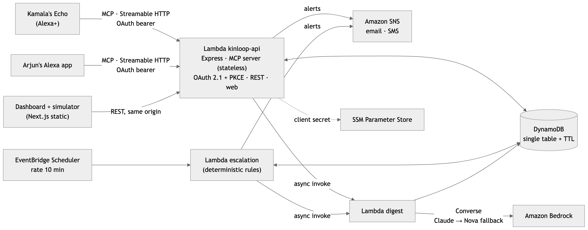
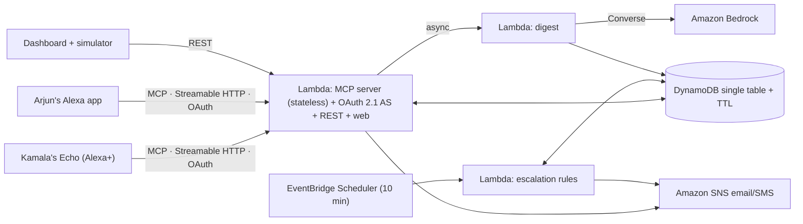

# KinLoop: your parents' daily check-in, through Alexa

**Track:** Alexa+ · **Mini challenge:** AWS Builder
**Repo:** https://github.com/Yashika2211/amazon (MIT)
**Live demo:** https://aitklljfxl5zbu3rgkec7e726m0yzgtm.lambda-url.ap-southeast-2.on.aws/simulator/

> KinLoop is not a medical device and does not replace emergency services. The demo household is fictional.

## Inspiration

Millions of adult children live far from their aging parents. In India, the parent is often in Jaipur or Lucknow while the child works in Bengaluru, Pune or abroad. The pattern is familiar. Parents forget the evening pill. They play down symptoms so they "don't worry anyone". The family finds out when something has already gone wrong.

Phone apps don't solve this, because many elders won't use them. **But they will talk.** We wanted the parent's whole interface to be a sentence, and the family's to be a calm answer to "How's Mom doing?", plus a call to action the moment it matters.

## What it does

KinLoop is an Alexa+ add-on: one self-hosted MCP server with two voices.

**The parent, at home:**
- "What do I need to do today?" Today's medicines with times and status, appointments, and family messages.
- "I just took my blood pressure pill." Matched by name or purpose to the nearest scheduled dose. Idempotent, so a repeat never double-counts.
- "I'm feeling okay, slept badly." A mood and sleep check-in.
- "I'm feeling dizzy and I nearly fainted." Fixed red-flag rules check for chest pain, breathlessness, a fall, fainting, confusion and stroke signs. A red flag alerts the family immediately, and Alexa tells the parent to call 112 or 911. Alexa doesn't call for them.
- "Ask my son to call me." "Any messages from my daughter?"

- **In Hindi too.** "मुझे सीने में दर्द हो रहा है" or "saans nahi aa rahi" trips the same deterministic red-flag rules as English. "BP ki goli le li" logs her Amlodipine.
- "You have about 4 days of Metformin left. I've let Arjun know." Each logged dose counts down the supply.

**The family, from their own Alexa or the dashboard:**
- "How's Mom doing today?" Doses taken or missed, the last check-in, the mood trend, alerts, and a warm two-to-three-sentence summary written by Amazon Bedrock.
- "Tell Dad I'll visit on Sunday." Queued and read out at the parent's next conversation.
- "I'm calling her now." Alerts are marked handled, and Kamala's Alexa tells her "Arjun has seen your alert". The loop closes on both sides.
- "Add Metformin 500 mg at 8 PM for Mom." / "I picked up 60 Metformin tablets." Always read back and confirmed before anything changes.

**Escalation is deterministic:**
- A missed dose gets a gentle reminder to the parent at 60 minutes and a family alert at 120.
- No check-in by 11 AM alerts the family.
- Three low-mood days in a row trigger a "consider calling" nudge.
- A red flag alerts the family immediately.

Every alert carries the reason and the numbers behind it, and alerts are deduplicated per incident.

**Rules decide. The LLM only writes.**

## How we built it

- **MCP server (TypeScript, `@modelcontextprotocol/sdk`):**
  - Spec 2025-11-25 over Streamable HTTP, fully stateless: a fresh server and transport per request, JSON responses, no `Mcp-Session-Id`. A test sends Alexa+'s exact `initialize` payload and expects version negotiation to 2025-03-26.
  - Nine tools with precise descriptions, Zod-validated inputs, and `readOnlyHint`, `destructiveHint` and `idempotentHint` annotations.
  - Every result returns `structuredContent` plus a spoken `content` text of the same facts. Schema errors come back as short spoken prompts, never stack traces.
  - `get_today_plan` and `get_parent_status` point `_meta.ui.resourceUri` at a 3 KiB MCP Apps card for Echo Show. The live demo renders it through `resources/read` and the real `ui/initialize` and `ui/notifications/tool-result` handshake.
- **Account linking:** a minimal OAuth 2.1 authorization server built into the app.
  - Authorization code with PKCE S256 only, the `resource` parameter, RFC 9728 Protected Resource Metadata and RFC 8414 AS metadata.
  - Rotating refresh tokens, including refresh without `resource`, as Alexa+ sends it.
  - Static clients only. Codes and tokens are stored as SHA-256 hashes, and PINs use scrypt.
  - Unauthenticated requests get a 401 with no `WWW-Authenticate`. The auth endpoints are rate-limited.
- **Rules engine (`packages/core`):** pure functions with 100% line, branch and function coverage.
- **Dashboard (Next.js, static export):**
  - Timeline, medicine chips, 7-day adherence and mood charts, alerts with acknowledgement, and a message composer.
  - The household setup flow, and the privacy and terms pages.
  - Large type, high contrast, dark mode, and it works on a phone.
- **Simulated Alexa+ client:** a real MCP client in which **Bedrock Claude tool use** (Converse) orchestrates calls to our MCP server.
  - Browser speech in and out.
  - A split screen, "Kamala's kitchen" and "Arjun in Bengaluru", with a live phone alert.
  - A trace panel with each tool call, its arguments and its latency.

### AWS services used and how (AWS Builder)

| Service | How KinLoop uses it |
|---|---|
| **Amazon Bedrock** | The digest Lambda calls the **Converse API** with Claude Haiku 4.5 (`au.` inference profile), falling back to Amazon Nova Lite (`apac.`) and then to a deterministic template. Every model output passes a deterministic check (no false "missed" claims, no unknown medicines, no advice, no dropped red flag) before it's stored. In production this caught Nova Lite calling a due dose "missed". The system prompt forbids medical advice and allows only restating logged facts. Model ID, latency and token usage are logged and stored with each digest. The simulated Alexa+ client also uses Converse **tool use** as its orchestrator. |
| **AWS Lambda** | Three functions: the API (MCP + OAuth + REST + static web) behind a **Function URL**; escalation; and the digest, invoked asynchronously (`InvocationType: Event`) so voice responses never wait on an LLM. |
| **Amazon DynamoDB** | One on-demand table with single-table design (households, members, medications, dose logs, check-ins, symptoms, messages, alerts, digests and OAuth artifacts). Conditional writes make dose logging and alert dedupe idempotent. TTL enforces the retention stated on the privacy page (90 days for health records). PITR and SSE are on. |
| **Amazon EventBridge Scheduler** | `rate(10 minutes)` invokes the escalation Lambda, which runs the deterministic rules for every household. |
| **Amazon SNS** | An encrypted topic with an email subscription for family alerts. Direct SMS to the caregiver's phone is optional. |
| **AWS Systems Manager Parameter Store** | A SecureString for the Alexa OAuth client secret, and optionally the Telegram bot token. |
| **AWS SAM / CloudFormation** | All infrastructure as code, deployed with one command (`pnpm deploy:aws`). Least-privilege IAM per function. |

## Challenges we ran into

- **Elicitation vs. statelessness.** Alexa+'s documented `initialize` doesn't advertise `elicitation`, and a stateless server can't receive the answer to a mid-call server request. We made the destructive tool a two-step call: preview, then `confirm: true`. Alexa+ asks the user in between.
- **Latency with an LLM in the product.** The family summary needs an LLM, but tools must answer in under 500 ms. We moved Bedrock to an async Lambda and added a freshness check. If anything was logged after the digest was written, `get_parent_status` speaks a deterministic live summary instead, so Arjun never hears stale facts.
- **Safety copy.** Every red-flag response tells the parent to call emergency services, says the family was alerted, and says plainly that Alexa can't call for them.
- **Production-only bugs:** behind Lambda, the MCP SDK's transport answered 415 to every call, because serverless-http leaves `rawHeaders` empty. Locally everything passed. We fixed it with a regression test that replays a real Function URL event.
- **Docs and tooling gaps:** the docs index returned 404, the CLI install command was missing, an unrelated `alexa-ai` package sits on npm, the flags for one command differ between pages, and the MCP Apps helpers don't type-check with the stable v1 SDK. All are logged with workarounds in the friction log.

## Accomplishments that we're proud of

- A safety design we can defend: no model decides who gets alerted.
- Deployed and measured: 17–68 ms p95 server time per tool on Lambda + DynamoDB, well inside Alexa+'s 500 ms budget.
- A deterministic guard on LLM output that caught a real false claim in production.
- Hindi and Hinglish red-flag detection in both Devanagari and romanized script, with Hindi's trailing negation handled.
- CI on every push: typecheck, the 100% coverage gate, integration tests, builds, SAM lint and Playwright.
- 100% coverage on the rules (69 tests), 63 MCP, OAuth, Lambda-path, digest and simulator integration tests (including a cross-household isolation test), and a Playwright smoke test that runs the OAuth and PKCE sign-in in a real browser.
- Spoken responses that sound like a person: "Got it. Your Amlodipine 5 mg for 8 AM is marked as taken. Next is Metformin 500 mg at 8 PM."

## What we learned

- Voice tools need two outputs: structured facts for the model, and a sentence a human wants to hear.
- Statelessness pays off. It made the server trivially horizontally scalable and the auth story simple, because the token is the context.
- LLMs belong where tone matters, not where liability lives.

## What's next for KinLoop

- **Spoken Hindi replies.** Hindi and Hinglish understanding already ships in the safety rules and the demo. Next are Hindi responses, then Tamil, Bengali and Marathi.
- **Ring integration** for fall and doorbell context ("No motion in the kitchen since 9 AM"), with consent.
- **Pharmacy ordering:** the refill countdown already ships. Next is ordering the refill from a partner pharmacy with one confirmation.
- Proactive notifications to the family's own Echo when the platform supports it.
- Audio messages from the family, in their own voice.
